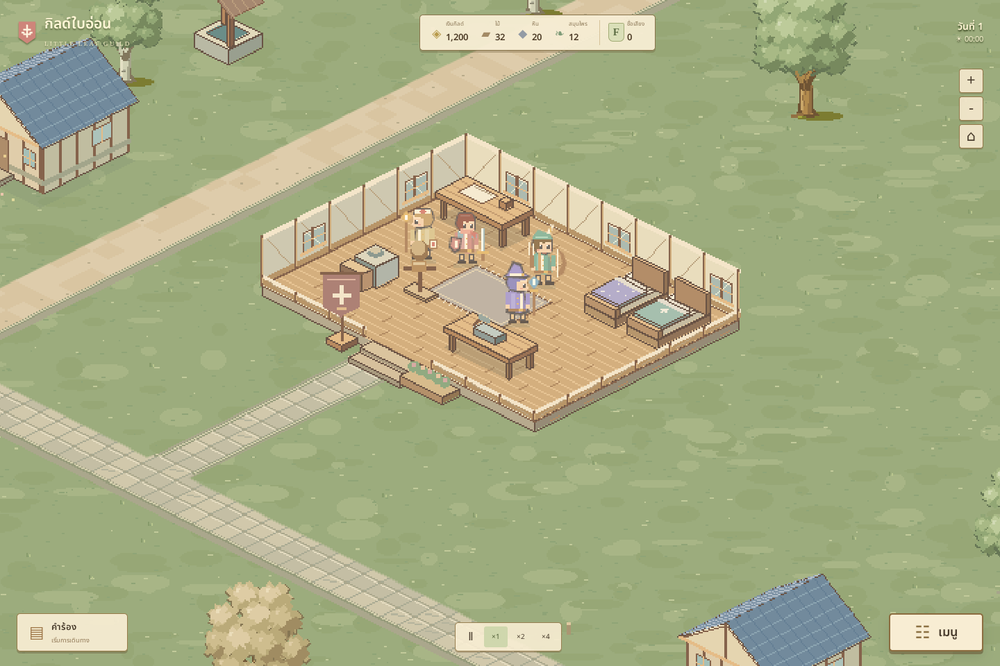
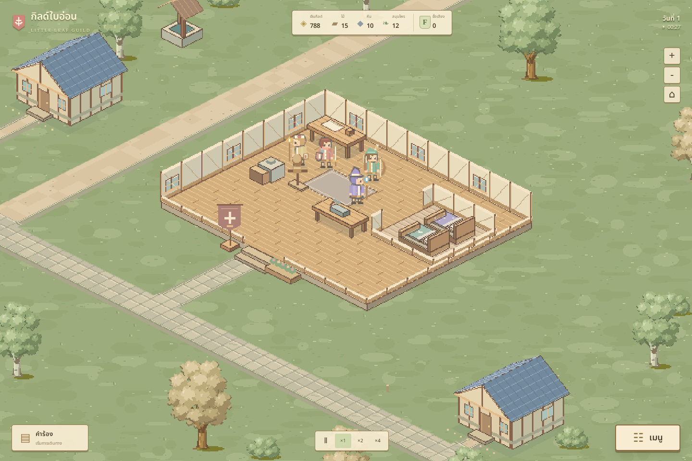
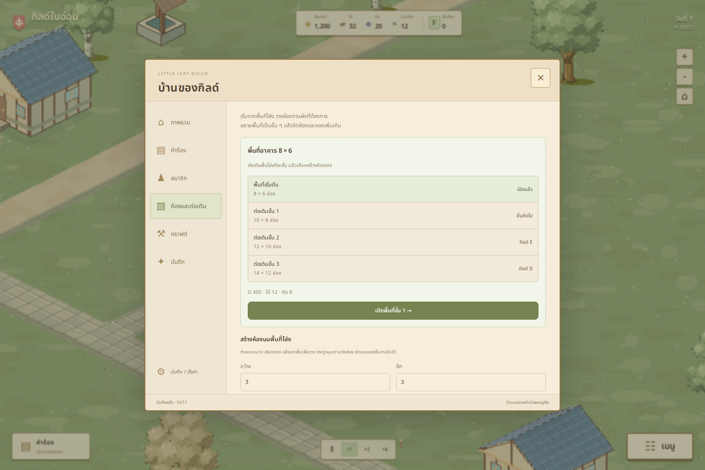

# Guild Master

เกมบริหารกิลด์นักผจญภัยพิกเซลโทน cozy anime สำหรับเว็บ ฉากเต็มหน้าจอและกิลด์เปิดหลังคาให้เห็นภายใน วางห้องและของบนพื้นโล่ง ต่อเติมอาคารทีละขั้น รับสมาชิก จัดทีม และพาคนกลับบ้านจากการเดินทาง

## เปิดเล่น

ไฟล์ดาวน์โหลดปัจจุบัน **R34: [play.html](play.html)** รวมโค้ด ภาพที่วาดในเกม และฟอนต์ไทยไว้แล้ว เริ่มจาก classic inline scripts โดยตรง ไม่ต้องโหลด ES module, แตก gzip, หรือเปิดสคริปต์ผ่าน Blob URL ถ้าเริ่มฉากไม่สำเร็จจะแสดงสาเหตุและปุ่มลองใหม่ใต้ชื่อรุ่น R34

R34 การค้าของกิลด์: มอนแต่ละพันธุ์ทิ้ง **ชิ้นส่วน** (หนังหมาป่า ผลึกค้างคาว ผงหมอก ฯลฯ) และบางครั้งนักผจญภัยเจอ **สมบัติ** บอสโลกเฝ้าสมบัติเสมอ กลับถึงบ้านแล้วขายของที่ **เคาน์เตอร์กิลด์** ตามราคารับซื้อที่ตั้งไว้ (กดราคา / ปกติ / ราคาดี: นักผจญภัยอิสระเลือกขายให้กิลด์ที่ให้ราคาดี) ของเก็บใน **โกดัง** แล้วทำกำไรได้หลายทาง: ขายส่งให้ร้านในเมือง (ยิ่งขายมากราคายิ่งตก) แปรรูปใน **โรงฟอกหนัง โรงปรุงยา ร้านเจียระไน** (3 ชิ้น → สินค้า 1 ชิ้น มูลค่า ×1.7 ชาวเมืองซื้อทุกเช้า) ส่ง **คาราวาน** ไปเมืองหลวง (ราคา ×1.35 มีใบสั่งซื้อโบนัส เสี่ยงโจรถ้าไม่จ้างผู้คุ้มกัน เห็นเกวียนวิ่งบนแผนที่) และสมบัติจะขายให้นักสะสมหรือ **จัดแสดง** ในตู้ของกิลด์เพื่อชื่อเสียงและค่าเข้าชม แท็บใหม่ **กิลด์ → การค้า**

R33 โลกที่มีชีวิต: นักผจญภัยออกไป **ล่ามอนเองแบบเรียลไทม์** ที่ทุ่งใบชา ป่าต้นโอ๊ก เนินผลึก และป่าหมอกจันทร์ (เปิดตามระดับกิลด์) ดูได้จากมุมมองพระเจ้าเหมือนเกมออนไลน์ แต่ละอาชีพมีสกิลของตัวเอง (กำแพงโล่ ยิงสามดอก ลูกไฟ แสงอวยพร) ใครหมดแรงจะ **สลบแล้วถูกเพื่อนหรือคนแบกเปลหามกลับ** ไม่มีใครตาย ของที่ล่าได้ขายในหมู่บ้าน กิลด์ได้ส่วนแบ่ง 20% และชื่อเสียง **นักผจญภัยอิสระ** พักที่โรงเตี๊ยม ล่ามอนเอง จ่ายค่าธรรมเนียม และชวนเข้ากิลด์ได้เมื่อประทับใจ หน้าสมาชิกจัดใหม่ตามสิ่งที่แต่ละคนกำลังทำ **ผู้เล่าเรื่อง** ส่งเหตุการณ์มาเป็นจังหวะ: เรื่องเล็กทุก 3–5 นาที เรื่องให้ตัดสินใจทุก 7–11 นาที (ชาวนาจ่ายไม่ไหว สมาชิกทะเลาะกัน แผนที่ขุมทรัพย์ สะพานพัง ฯลฯ) และเหตุการณ์ใหญ่ทุก 17–25 นาทีพร้อมช่วงสงบหลังจากนั้น (**มอนบุกหมู่บ้าน** **บอสโลก** **คนดังมาเยือน** **พายุใหญ่**) มอนบุกกับบอสเกิดขึ้นจริงบนแผนที่และกด “ดู” เพื่อให้กล้องตามได้ คำร้องทั่วไปขึ้นกระดานเองตามค่าตอบแทนปกติ (ปิดได้) ผู้เล่นจึงมีเวลาพัฒนากิลด์และหมู่บ้าน เดโม่ F–C ยาวราว 1.5–2 ชั่วโมง

R32 นักผจญภัยเติบโตเอง: สมาชิกแต่ละคนมี **แรงค์ F–S** ของตัวเอง (เดโม่ถึง C) เลื่อนด้วยเลเวล แต้มผลงานส่วนตัว และ **การสอบที่สนามสอบ** แรงค์กำหนดระดับงานที่รับได้ (ไม่เกินแรงค์ +1) และเพิ่มพลัง **โรงฝึก** ในหมู่บ้านมีคอร์สฝึกกับครูที่สมาชิกจ่ายค่าเรียนเอง และพิธีเปลี่ยนคลาส คลาสมี 3 ขั้น: อาชีพพื้นฐาน → คลาสขั้น 2 (แรงค์ D, Lv.5) → คลาสขั้น 3 อีก 8 แบบ (แรงค์ B ในเกมเต็ม) สมาชิกเดินไปเรียนและไปสอบบนแผนที่จริง ทีมจากกระดานพารุ่นน้องไปด้วยเพื่อให้มือใหม่ได้โต

R31 จังหวะของเกมเต็ม: เดโม่นี้คือบทแรก (กิลด์ F–C ราว 1–2 ชั่วโมง) ของเกมที่ตั้งเป้า 8–10 ชั่วโมง ระดับกิลด์ต้องใช้ทั้ง **ชื่อเสียงและผลงาน** (จำนวนงาน ชนิดงาน สมาชิก หมู่บ้าน อาวุธ เลเวล) แล้วสมาคมจึงส่ง **จดหมายสอบเลื่อนระดับ** งานที่ต่ำกว่าระดับกิลด์ให้ชื่อเสียงน้อยลง ชื่อเสียงดึง **นักผจญภัยหน้าใหม่** ให้เดินมาสมัครเอง และ **คนดัง** มาเมื่อกิลด์เหมาะกับเขา นักผจญภัยใช้ค่าจ้างของตัวเองซื้อเสบียง ยา อาวุธ และซ่อมของในหมู่บ้าน ร้านเติมของจาก **ตลาดหมู่บ้าน** ที่ราคาขึ้นลงตามวัตถุดิบที่กิลด์ขาย ระดับ B ขึ้นไปจะเปิดพร้อมแผนที่ใหม่ในเกมเต็ม

R30 คำร้องไหลเข้ามาเอง: ชาวบ้านเดินจากบ้านมาส่งคำร้องที่โต๊ะ กิลด์เลือกรับหรือปฏิเสธและตั้งค่าตอบแทน (ใจดี / มาตรฐาน / ประหยัด) นักผจญภัยที่ว่างเดินไปหยิบงานจากกระดานเอง ผู้เล่นเลือกทีมเองหรือจองงานสำคัญได้ กิลด์ได้ค่านายหน้า ทีมได้เงินส่วนตัวไปใช้ในร้านค้า แท็บ **หมู่บ้าน** มีการพัฒนากิลด์แบบไอเดิล (ป้ายประกาศ สมุดสัญญา เสมียน กองทุนที่จ่ายต่อแม้ปิดเกม) และโครงการหมู่บ้าน (บ้านใหม่ ร้านค้า ตลาดนัด โรงตีเหล็ก) บ้านบนแผนที่ขึ้นบนที่ดินว่างและโตขึ้นตามระดับหมู่บ้าน

R12 ช่วยผู้เล่นใหม่: กล่องเป้าหมายมุมซ้ายบอกขั้นต่อไปและกดพาไปหน้าที่ต้องใช้ ปุ่มคำร้องเรืองแสงเมื่อไม่มีทีมออกงาน ไม่เก็บค่าดูแลกิลด์จนกว่าภารกิจแรกสำเร็จ และมีหน้าสรุปผลเมื่อทีมกลับบ้าน (รางวัล XP เลเวลอัป การเลื่อนระดับกิลด์ และเป้าหมายถัดไป)

R8 แก้ฉากว่างเหลือแต่สีพื้นเขียวบน Android: เบราว์เซอร์มือถืออาจล้างภาพ canvas ของแท็บที่อยู่เบื้องหลัง เกมจะตรวจทุก 3 วินาทีและเมื่อกลับมาที่แท็บ ถ้าภาพหายจะวาดฉากใหม่เอง R9 ใช้ canvas แบบซอฟต์แวร์ (ไม่พึ่ง GPU) เมื่อเปิดไฟล์ผ่าน content:// และแสดงข้อมูลตรวจใต้ข้อความถ้าฉากยังไม่ขึ้น

ทดสอบไฟล์ R7 โดยปิด WebGL, DecompressionStream, Blob URL และการโหลดสคริปต์แบบ dynamic แล้วฉาก พื้น ผนัง ถนน บ้าน วางห้องและเซฟ/โหลดทำงานใน Chromium ยังไม่ได้ยืนยันการเปิด content:// บนอุปกรณ์ Android จริง

เว็บที่เผยแพร่ก่อนหน้า **[รุ่น R6](https://little-leaf-guild-play.ballboy-lnw.chatgpt.site)** ยังเป็น R6; การแก้ตัวโหลดรอบนี้อยู่ในไฟล์ดาวน์โหลด R7

```bash
npm ci
npm start
```

เปิด `http://localhost:5173` ใช้ Node.js 20 ขึ้นไป ใช้ Phaser 3.90.0 ที่ติดตั้งไว้ในโครงการ ไม่โหลดจาก CDN ระหว่างเล่น ใช้ WebGL เมื่อเปิดได้ และใช้ตัววาด Canvas ของ Phaser เมื่อ WebGL เปิดไม่ได้ ไฟล์ Android ที่เปิดผ่าน content:// ใช้ตัววาด Canvas โดยตรง

## ระบบที่เล่นได้ในเวอร์ชันแรก

- สมาชิกเริ่มต้น 4 คน ตัวละครมีชื่อ 12 คน (4 คนเป็นคนดังที่มาเมื่อกิลด์เหมาะ) และนักผจญภัยหน้าใหม่ที่สุ่มขึ้น รับได้ตามความจุจุดพัก สูงสุด 12 คน
- อาชีพหลัก 4 สาย มีสายเชี่ยวชาญ 8 แบบ อุปกรณ์คนละ 2 ช่อง
- คำร้อง 9 แบบใน 3 พื้นที่ กิลด์ F → C (เดโม่ราว 1 ชั่วโมง) พร้อมบทสุดท้ายและเล่นต่อ เลื่อนระดับด้วยชื่อเสียง ผลงาน และการสอบ ชาวบ้านเดินมาส่งคำร้อง กิลด์ตั้งค่าตอบแทนและเก็บค่านายหน้า
- กระดานคำร้องให้นักผจญภัยที่ว่างหยิบงานเอง งานสำคัญจองไว้ให้ผู้เล่นเลือกทีม
- หมู่บ้าน 5 ระดับ: บ้านใหม่ ร้านค้า ตลาดนัด โรงตีเหล็ก และการพัฒนากิลด์แบบไอเดิล 4 อย่าง
- ทีมละ 3 คน เริ่มหนึ่งทีม วางโต๊ะวางแผนเมื่อระดับ E เพื่อส่งสองทีม
- พลังงาน ขวัญ อาการบาดเจ็บ คิวฝึก/พัก/รักษา และความไว้ใจระหว่างสมาชิก
- จุดใช้งาน 10 ประเภท วางอิสระครั้งละ ¼ ช่อง หมุน 4 ทิศ ย้าย/รื้อ/อัปเกรด 3 ระดับ
- เริ่มพื้นโล่ง ไม่มีห้องสำเร็จรูป สร้างห้อง 7 ชนิด กำหนดกว้าง/ลึกเอง วาง ย้าย หมุน ปรับขนาด และรื้อผนังได้
- ย้ายหรือหมุนห้องพร้อมของภายใน ตรวจประตูและเส้นทางเดินก่อนเปลี่ยนผัง
- ต่อเติมพื้นทีละขั้น 8×6 → 10×8 → 12×10 → 14×12 ขั้นถัดไปต้องกิลด์ F/E/D ตามลำดับ แยกจากซื้อที่ดินเพิ่ม 2 ครั้ง
- ถนนหินและทางดินต่อถึงประตู ตรวจทางเดินและกันของทับถนน ต้นไม้ และทางเข้า
- คราฟต์อุปกรณ์ 10 แบบ กิจกรรมน้ำชา/มื้อเลี้ยง และบัญชีรายรับรายจ่าย
- เหตุการณ์ในภารกิจสำคัญ เลือกแนวทางเดินทาง ดูฉากต่อสู้อัตโนมัติ หรือกลับไปบริหารกิลด์
- เวลา ×1 / ×2 / ×4 และหยุดเวลา เกมหยุดจำลองขณะอยู่เบื้องหลัง
- บันทึกอัตโนมัติ สำรองเซฟ นำเข้า/ส่งออก JSON และตรวจข้อมูลเสียหาย
- เมาส์และสัมผัส เลื่อนฉาก/ซูม/เลือกของและสมาชิก

การต่อสู้เป็นการจำลองตามพลังทีม บทบาท อุปกรณ์ สภาพคน และการตัดสินใจ ไม่ใช่ระบบบังคับตัวละครต่อสู้เอง

## การควบคุม

กด **เมนู** หรือ **คำร้อง** ที่มุมล่าง → เลือกคำร้อง → เลือกสมาชิกให้ครบ 3 คน → เลือกแนวทาง → ส่งทีม ช่วงรอจัดตารางคนที่อยู่บ้าน คราฟต์อุปกรณ์ หรือต่อเติมกิลด์ได้ กดการ์ดทีมที่ออกเดินทางเพื่อดูการต่อสู้และเหตุการณ์

ลากฉากเพื่อเลื่อน ใช้ +/−, ล้อเมาส์ หรือสองนิ้วเพื่อซูม เมนู → ห้องและต่อเติม เลือกขนาดและชนิดห้อง แล้วแตะพื้นเพื่อสร้าง กดพื้นว่างในห้องเพื่อย้าย/หมุน/ปรับขนาด กดของเพื่ออัปเกรด/ย้าย/หมุน กดคนเพื่อดูรายละเอียด `Space` หยุดเวลา, `1`/`2`/`4` เปลี่ยนความเร็ว, `R` หมุนขณะวาง, `Esc` ปิดเมนูหรือยกเลิกการวาง

เมนู → บันทึก / ตั้งค่า เปิดการบันทึก ส่งออก/นำเข้าเซฟ เสียง และเริ่มเกมใหม่ เซฟรุ่นห้องต่อกัน v1/v2 จะจัดของเข้าสู่อาคารเดียวและเก็บสมาชิก เลเวล ทรัพยากร และภารกิจไว้ เซฟ v3 เก็บผังของเดิมและเพิ่มรายการห้องว่างเป็น v4 เซฟ v5 (R30) เพิ่มคำร้อง หมู่บ้าน และการพัฒนากิลด์ เซฟเก่าเริ่มด้วยกระดานว่างและหมู่บ้าน 3 หลัง เซฟอยู่ในเบราว์เซอร์นี้ ไม่มี cloud save ควรส่งออกก่อนล้างข้อมูลหรือย้ายเครื่อง

## ตรวจและสร้างไฟล์เว็บ

```bash
npm test
npm run build
npm run export
```

`build` เตรียมเว็บหลายไฟล์ใน `dist/`; `export` สร้างไฟล์เดี่ยว `play.html` ใหม่จาก source ปัจจุบัน เมื่อแก้ source ต้องรัน export ก่อนส่งไฟล์เดี่ยวให้ผู้เล่น

ชุดตรวจ engine 34 รายการผ่าน รวมจำลองการเล่นเดโม่ตั้งแต่ต้นจนจบ 5 seed (ต้องจบใน 50–120 นาทีเกม) (`npm run balance` ดูรายงานสมดุล) รวมเล่นจากสมาชิกเริ่มต้นถึงตอนจบด้วยทรัพยากรที่หาได้จริง มี browser smoke test เสริม:

```bash
PLAYWRIGHT_MODULE=/path/to/playwright/index.mjs BROWSER_EXECUTABLE=/path/to/chromium node tests/ui-smoke.mjs
node tests/rooms-smoke.mjs
node tests/boot-smoke.mjs
node tests/standalone-compat.mjs
```

ค่าเริ่มต้นของ browser smoke เป็นพาธ runtime ของสภาพแวดล้อมผู้พัฒนา หากรันที่อื่นให้ระบุสองตัวแปรข้างต้น ตรวจการจัดทีม เหตุการณ์ รางวัล คราฟต์ อัปเกรด ย้ายของ และเซฟ/โหลด ส่วน rooms-smoke ตรวจไฟล์ส่งจริง การสร้างห้อง หมุน/ย้ายพร้อมของ ต่อเติมและล็อกตามกิลด์ มือถือ 390×844 เซฟ/โหลด และเปิด offline

การตรวจ boot-smoke เปิดไฟล์ส่งจริงโดยปิด WebGL และจำลอง GPU context หายกลางเกม ตรวจว่าฉากกลับมา วางห้อง ซูม และบันทึก/โหลดได้ โดยรักษาความคืบหน้า ใช้ Chromium และ viewport มือถือจำลอง ยังไม่ได้ทดสอบ Samsung Internet บนอุปกรณ์จริง

`standalone-compat` ตรวจโครงสร้างสคริปต์และเปิดไฟล์ R7 จริงโดยไม่มีตัวโหลด Blob/DecompressionStream ตรวจพิกเซลพื้นว่างและถนน รวมพื้นที่หญ้าและหลังคาบ้านเพื่อปฏิเสธฉากสีเรียบที่มีแต่ของ ทดสอบ Canvas/WebGL วางห้อง เซฟ/โหลด viewport 390×844 และจำลอง Canvas เปิดไม่ได้เพื่อตรวจข้อความผิดพลาด

## ขอบเขตปัจจุบัน

เวอร์ชันนี้เป็นต้นแบบแคมเปญที่เล่นจบได้ เนื้อหา 9 คำร้องยังไม่ใช่เกมเต็ม 6–8 ชั่วโมง การเล่นอัตโนมัติผ่านเส้นทางตัวอย่างใช้เวลาเกมประมาณ 72 นาทีที่ ×1 หรือ 18 นาทีที่ ×4 **ก่อนรวมเวลาจัดการ UI** ตัวเลขนี้มาจากการจำลอง ไม่ใช่เวลาเล่นของผู้เล่นจริง

ยังต้องปรับสมดุลจากการเล่นจริง เพิ่มความหลากหลายของคำร้อง/บทสนทนา และขัดเกลาภาพ เสียง และการเข้าถึงก่อนเรียกว่าเกมพร้อมจำหน่าย

รายละเอียดระบบและข้อจำกัด: [docs/GAME-DESIGN-TH.md](docs/GAME-DESIGN-TH.md) · หลักฐานตรวจ: [docs/VALIDATION.md](docs/VALIDATION.md)

## ทรัพย์สิน

ฉากหลักใช้ **Phaser + WebGL** และกริด **isometric 2:1**; พื้น ผนัง เฟอร์นิเจอร์ และบ้านรอบกิลด์วาดสำหรับมุมเฉียงเดียวกัน จัดลำดับการบังตามตำแหน่งบนพื้น และแปลงการแตะ/วางของกลับเป็นพิกัดกริด; Canvas 2D ใช้เตรียมเท็กซ์เจอร์พิกเซลและภาพเล็กในเมนู งานสไปรต์และสภาพแวดล้อมสร้างสำหรับโครงการนี้ ฟอนต์ Noto Sans Thai ใช้ SIL Open Font License ดู [assets/fonts/OFL.txt](assets/fonts/OFL.txt) และ metadata ในฟอนต์

[Dungeon Village 2 — Kairosoft](https://kairosoft.net/game/appli/bouken2.html) เป็นเรฟมุมเฉียงแบบ isometric และแรงบันดาลใจเรื่องการเติบโตของสถานที่และนักผจญภัย ไม่มีการนำทรัพย์สินเกมนั้นมาใช้

[Pixel Art Top Down — Village โดย Cainos](https://cainos.itch.io/pixel-art-top-down-village) เป็นเรฟวัสดุและภาษาภาพ ไม่ได้รวมทรัพย์สินของ Cainos ในเกม Phaser ใช้ MIT License ซึ่งแนบอยู่ใน build และไฟล์เดี่ยว






